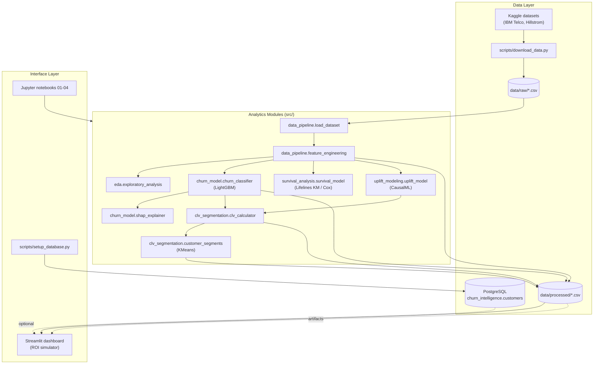

# Architecture & Data/API Documentation

Customer Lifetime Value & Churn Intelligence System — a retention decision engine that
predicts **who will churn**, **how long customers survive**, **how much they are worth**,
and **which offers are worth their cost**.

---

## 1. System Architecture



### 1.1 Pipeline stages

| Stage | Module | Responsibility |
|-------|--------|----------------|
| Ingest | `data_pipeline.load_dataset` | Load real Kaggle CSVs from `data/raw` (fallback: kagglehub → synthetic). Build `(X, treatment, y)` for uplift. |
| EDA | `eda.exploratory_analysis` | Summary statistics + distribution / correlation / contract plots. |
| Features | `data_pipeline.feature_engineering` | Add domain features; encode categoricals into a model-ready matrix. |
| Churn | `churn_model.churn_classifier` | LightGBM binary classifier with early stopping + metrics. |
| Explain | `churn_model.shap_explainer` | SHAP beeswarm / bar / waterfall + mean-\|SHAP\| importance. |
| Survival | `survival_analysis.survival_model` | Kaplan-Meier (overall + by contract) and Cox PH. |
| Uplift | `uplift_modeling.uplift_model` | CausalML `BaseSClassifier` (T-learner fallback), uplift segments, Qini curve. |
| Value | `clv_segmentation.clv_calculator` | Discounted cash-flow CLV + offer revenue-impact. |
| Segment | `clv_segmentation.customer_segments` | KMeans clustering + auto-labelled profiles. |
| Serve | `streamlit_app.app` | Interactive dashboard with the ROI simulator. |

---

## 2. Data Documentation

### 2.1 Raw datasets (`data/raw/`)

| File | Source (Kaggle slug) | Rows | Purpose |
|------|----------------------|------|---------|
| `telco_customer_churn.csv` | `blastchar/telco-customer-churn` | 7,043 | Churn, survival, CLV, segmentation |
| `hillstrom_email_marketing.csv` | `sumittarya/hillstrom-email-marketing` | 64,000 | Real randomized uplift modeling |

**Telco columns (21):** `customerID`, `gender`, `SeniorCitizen`, `Partner`,
`Dependents`, `tenure`, `PhoneService`, `MultipleLines`, `InternetService`,
`OnlineSecurity`, `OnlineBackup`, `DeviceProtection`, `TechSupport`, `StreamingTV`,
`StreamingMovies`, `Contract`, `PaperlessBilling`, `PaymentMethod`,
`MonthlyCharges`, `TotalCharges`, `Churn`.

> `TotalCharges` is delivered as text and contains blank entries for brand-new
> customers (`tenure = 0`); the pipeline coerces it to numeric and imputes the median.

**Hillstrom columns (12):** `recency`, `history_segment`, `history`, `mens`,
`womens`, `zip_code`, `newbie`, `channel`, `segment`, `visit`, `conversion`, `spend`.

> `segment` is the randomized assignment (`Mens E-Mail` / `Womens E-Mail` / `No E-Mail`).
> `No E-Mail` is the **control** group → genuine causal effects.

### 2.2 Engineered features (`engineer_features`)

| Column | Description |
|--------|-------------|
| `tenure_group` | Tenure bucket: 0-12, 13-24, …, 61-72 months |
| `avg_monthly_charge` | `TotalCharges / max(tenure, 1)` |
| `charge_increase` | `MonthlyCharges − avg_monthly_charge` (recent price-hike signal) |
| `num_services` | Count of active subscribed services |
| `has_internet`, `has_phone` | Binary service flags |
| `contract_risk` | 1 for Month-to-month contracts |
| `auto_pay` | 1 for automatic payment methods |
| `is_senior_no_support` | Senior without tech support or online security |
| `high_value` | 1 if `MonthlyCharges > 70` |
| `tenure_x_monthly` | `tenure × MonthlyCharges` interaction |

`prepare_model_data` drops `customerID`, `Churn` and `treatment`, and label-encodes all
remaining categoricals → a **30-column** feature matrix `X` plus binary target `y`.

### 2.3 Processed outputs (`data/processed/`)

| File | Producer | Key columns |
|------|----------|-------------|
| `telco_churn_processed.csv` | Notebook 01 | Raw + engineered features |
| `telco_churn_scored.csv` | Notebooks 02/04 | `+ churn_probability`, `clv`, `segment`, `segment_label`, `uplift_score`, `uplift_segment` |
| `training_snapshot.csv` | Notebook 04 | Engineered frame incl. `treatment` |
| `retention_decisions.csv` | Notebook 04 | `customerID`, `churn_probability`, `uplift_score`, `uplift_segment`, `clv`, `segment`, `segment_label`, `MonthlyCharges`, `expected_retention_months_gained`, `revenue_from_retention`, `roi`, `net_value` |

### 2.4 Model artifacts (`models/`)

| File | Contents |
|------|----------|
| `churn_lgbm_model.pkl` | joblib bundle: fitted LightGBM model, feature names, params |
| `churn_metrics.json` | accuracy, precision, recall, f1, auc_roc, auc_pr |

---

## 3. API Reference

### `data_pipeline.load_dataset`

```python
load_telco_data(add_synthetic_treatment: bool = False) -> pd.DataFrame
load_hillstrom_data() -> pd.DataFrame
prepare_uplift_data(df, outcome="visit") -> tuple[pd.DataFrame, pd.Series, pd.Series]
telco_raw_path() -> str          # os.path.join based
hillstrom_raw_path() -> str
```

- `load_telco_data` resolution order: local `data/raw` → kagglehub → synthetic.
- `prepare_uplift_data` returns `(X, treatment, y)` where `treatment = 1` for any e-mail
  campaign and `0` for `No E-Mail`; features are `recency`, `history`, `mens`, `womens`,
  `newbie`, plus one-hot `zip_code` and `channel`.

### `data_pipeline.feature_engineering`

```python
engineer_features(df: pd.DataFrame) -> pd.DataFrame
prepare_model_data(df: pd.DataFrame) -> tuple[pd.DataFrame, pd.Series]  # (X, y)
```

### `churn_model`

```python
ChurnClassifier(params=None)
  .train(X_train, y_train, X_val, y_val) -> dict[str, float]
  .predict(X) -> np.ndarray                 # churn probabilities
  .predict_class(X, threshold=0.5) -> np.ndarray
  @staticmethod .train_and_evaluate(df) -> (classifier, metrics, X_test, y_test)
  .save_model(path=None) / .load_model(path=None)

ShapExplainer(model, X_data)
  @staticmethod .generate_explanations(classifier, X_test, save_dir=None) -> ShapExplainer
  .get_feature_importance_shap() -> pd.DataFrame  # feature, mean_abs_shap
```

### `survival_analysis`

```python
SurvivalAnalyzer()
  .fit_kaplan_meier(durations, event_observed, label="Overall")
  .fit_kaplan_meier_by_group(df, group_col="Contract") -> dict[str, KaplanMeierFitter]
  .fit_cox_model(df, covariates=None)
  .get_cox_summary() -> pd.DataFrame        # coef, exp(coef), p, ...
  @staticmethod .run_full_analysis(df) -> SurvivalAnalyzer
```

### `uplift_modeling`

```python
UpliftModeler()
  .fit(X, treatment, y)                     # causalml BaseSClassifier, T-learner fallback
  .predict_uplift(X) -> np.ndarray          # positive => treatment reduces churn
  .get_uplift_segments(X, treatment, y) -> pd.DataFrame
                                            # uplift_score, segment, treatment, churn
  # segments: Persuadable | Sure Thing | Lost Cause | Sleeping Dog
```

### `clv_segmentation`

```python
CLVCalculator(discount_rate=None, margin_rate=None)
  .compute_simple_clv(monthly_charges, expected_tenure_months) -> float
  .compute_clv_for_dataframe(df) -> pd.Series
  .compute_expected_revenue_impact(df, uplift_scores, offer_cost) -> pd.DataFrame
       # expected_retention_months_gained, revenue_from_retention, roi, net_value
  @staticmethod .compute_all_clv(df, churn_probs=None) -> pd.DataFrame   # adds `clv`

CustomerSegmenter(n_clusters=None)         # defaults to N_CLUSTERS = 4
  @staticmethod .run_segmentation(df) -> (segmenter, segments_df, profiles)
```

---

## 4. Configuration (`config/settings.py`)

| Key | Default | Meaning |
|-----|---------|---------|
| `DISCOUNT_RATE_ANNUAL` | `0.10` | Annual discount rate for CLV |
| `AVERAGE_MONTHLY_MARGIN` | `0.30` | Margin fraction of monthly charges |
| `N_CLUSTERS` | `4` | KMeans segment count |
| `LIGHTGBM_PARAMS` | see file | Classifier hyper-parameters |
| `DB_CONFIG` / `DATABASE_URL` | env-driven | PostgreSQL connection |

Environment variables: `DB_HOST`, `DB_PORT`, `DB_NAME`, `DB_USER`, `DB_PASSWORD`.

### PostgreSQL

`scripts/setup_database.py` engineers the data, saves the processed CSV, then loads it
into the `customers` table of the `churn_intelligence` database via
`data_pipeline.db_manager.DatabaseManager`. It degrades gracefully (logs a warning and
continues) when no database is reachable.

---

## 5. Path Handling

Every module and notebook builds paths with `os.path.join`. Notebooks resolve the
project root by walking up from the current working directory until the folder
containing both `src/` and `config/` is found:

```python
PROJECT_ROOT = find_project_root(os.getcwd())
DATA_RAW = os.path.join(PROJECT_ROOT, "data", "raw")
```

This keeps the code portable across Jupyter, VS Code, `jupyter nbconvert`, scripts and
the Streamlit app with no hard-coded absolute paths.
